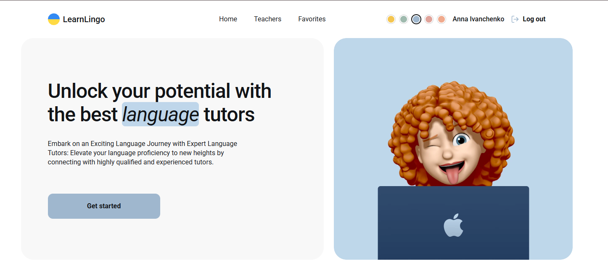
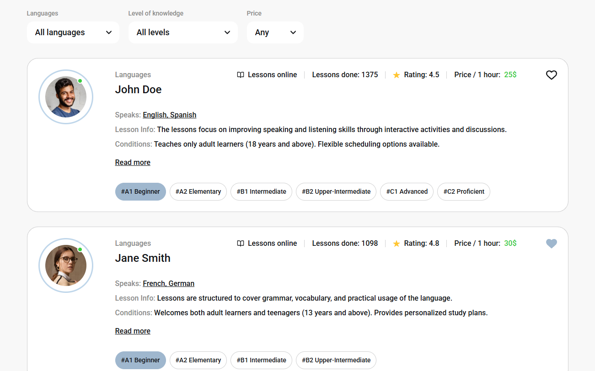
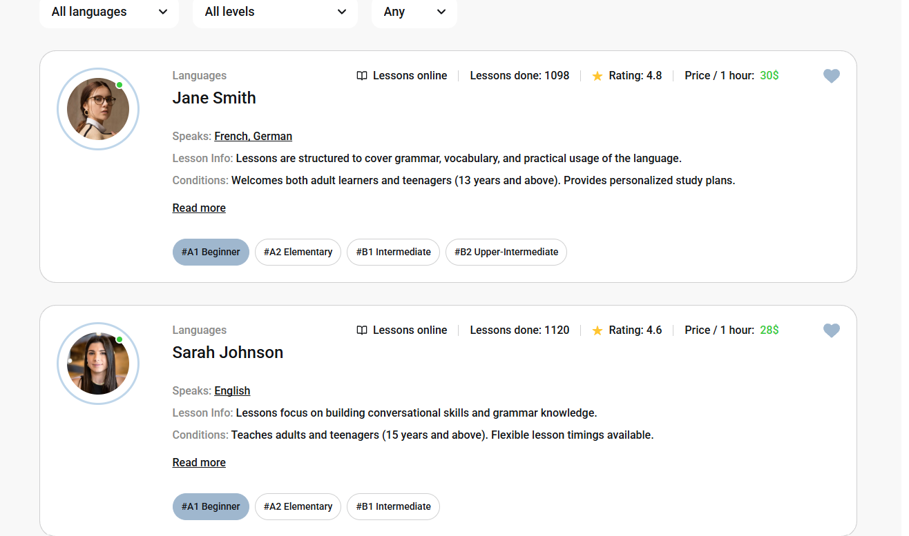

<p align="right">🇬🇧 English | 🇺🇦 <a href="README.uk.md">Українська</a></p>

# LearnLingo


A web application for a company that offers online lessons with language teachers. Users can browse and filter teachers, save their favorites, book a trial lesson and switch the color theme.

🎨 **Design:** [Figma mockup](https://www.figma.com/design/dewf5jVviSTuWMMyU3d8Mc/Learn-Lingo?node-id=0-1)

## Pages

- **Home**: the company's advantages and a link to the Teachers page.

  

- **Teachers**: a list of teachers that can be filtered by language, student level and price per hour.

  

- **Favorites**: a private page with the teachers the user has added to favorites.

  

## Features

- Registration, login and logout with Firebase Authentication
- Teacher cards with a "Read more" section that shows details and student reviews
- Filters by language, level and price
- "Load more" fetches the next 4 teachers from the database with a new request
- Favorites stored in Firebase Realtime Database, kept after a page refresh; guests see a message instead
- Booking form for a trial lesson (react-hook-form + yup, all fields required)
- Modal windows close with the close button, a click on the backdrop or the Esc key
- 5 color themes switched with CSS variables
- Responsive layout: desktop (1440px and up), tablet and mobile with a burger menu

## Tech stack

React 19, TypeScript, Vite, React Router 7, Firebase (Authentication and Realtime Database), react-hook-form, yup, react-hot-toast, react-icons, CSS Modules.

## Technical specification

1. Authentication with Firebase: registration, login, current user data, logout.
2. Registration, login and booking forms use react-hook-form and yup. All fields are required.
3. A teachers collection in Firebase Realtime Database with the fields: name, surname, languages, levels, rating, reviews, price_per_hour, lessons_done, avatar_url, lesson_info, conditions, experience.
4. The Teachers page shows 4 cards; the rest are loaded with a new database request on "Load more".
5. The heart button: guests get a notification, authorized users add or remove the teacher from favorites.
6. React Router routing, a private Favorites page and filters by language, level and price.

## Pagination

The Teachers page loads teachers 4 at a time with a database query (`orderByKey` + `limitToFirst`, then `startAfter` the last loaded key). Favorites loads the saved teachers by id in the same way. When a filter is selected, the remaining teachers are loaded with one request so the filter covers everyone.

## Getting started

```bash
git clone https://github.com/Anna-Ivanchenko/learn-lingo.git
cd learn-lingo
npm install
cp .env.example .env
npm run dev
```

Fill in your Firebase keys in `.env` (see `.env.example`; every variable starts with `VITE_FIREBASE_`).

Other commands: `npm run build`, `npm run lint`, `npm run preview`.

## Deploy

The app is a single-page application, so a fallback to `index.html` is needed:

- Netlify: `public/_redirects`
- Vercel: `vercel.json`

## Project structure

```
src/
├── components/   UI components (Header, TeacherCard, Modal, ...)
├── contexts/     Auth, Favorites and Theme contexts
├── hooks/        useAuth, useFavorites, useTeachers, ...
├── pages/        Home, Teachers, Favorites
└── utils/        helpers (for example getAuthErrorMessage)
```

## Author

**Anna Ivanchenko**
[GitHub](https://github.com/Anna-Ivanchenko)
